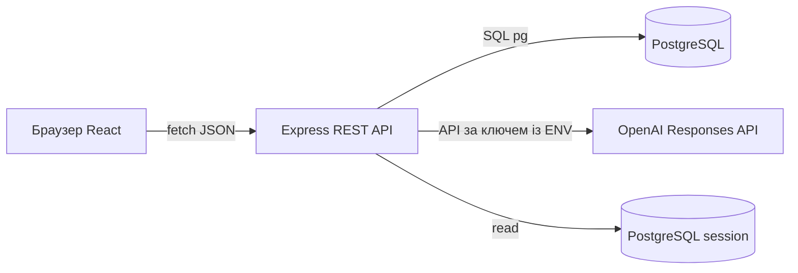

# Порядок виконання лабораторних №2–6 (Stargazing)

Це **один проєкт**, що послідовно розширює лабораторну №1. Не створюй п’ять окремих сайтів, і не замінюй репозиторій першої лабораторної.

## Схема взаємодії

## Порядок і докази

| № | Тема | Що перевіряємо | Скриншоти |
|---|---|---|---|
| 2 | React та динамічний інтерфейс | React-сторінка, фільтр, SQL-таблиця `services` | код React, сторінка, фільтр, pgAdmin |
| 3 | Сервер та REST API | Express, GET/POST, OpenAPI YAML, Postman | термінал сервера, 200 GET, 201 POST, 422, SQL-запис, OpenAPI |
| 4 | Дані користувача | Форма, перевірка, сесія, localStorage, захист | форма, валідація, успіх, Local Storage, cookie HttpOnly, server-code |
| 5 | Render та моніторинг | онлайн-URL, ENV без секретів, Health, Metrics, Logs | Render Events, сайт, /api/health, вкладка Environment із **замаскованими** секретами, metrics |
| 6 | AI API | ключ у ENV, запит з React, відповідь | AI-форма, успішна відповідь, Postman/Network 200, код сервера з прихованим ключем |

Після кожного етапу роби скриншот, перш ніж переходити до наступного.

### Статуси

- **Підготовлено тут:** вихідні файли, SQL, REST, специфікація, Postman-колекція, Render-Blueprint, AI endpoint, навчальні тексти.
- **Автоматично перевірено:** 8 перевірок валідації, синтаксис серверних JS-файлів та JSX, структура JSON і YAML.
- **Не виконано без твоїх середовищ:** фактичний запуск PostgreSQL у Windows, реальні запити Postman, Render deployment та реальний виклик платного AI API.

Таке розділення важливе для академічно достовірного звіту: результати, що потребують твого середовища, відображай лише після власної перевірки.
